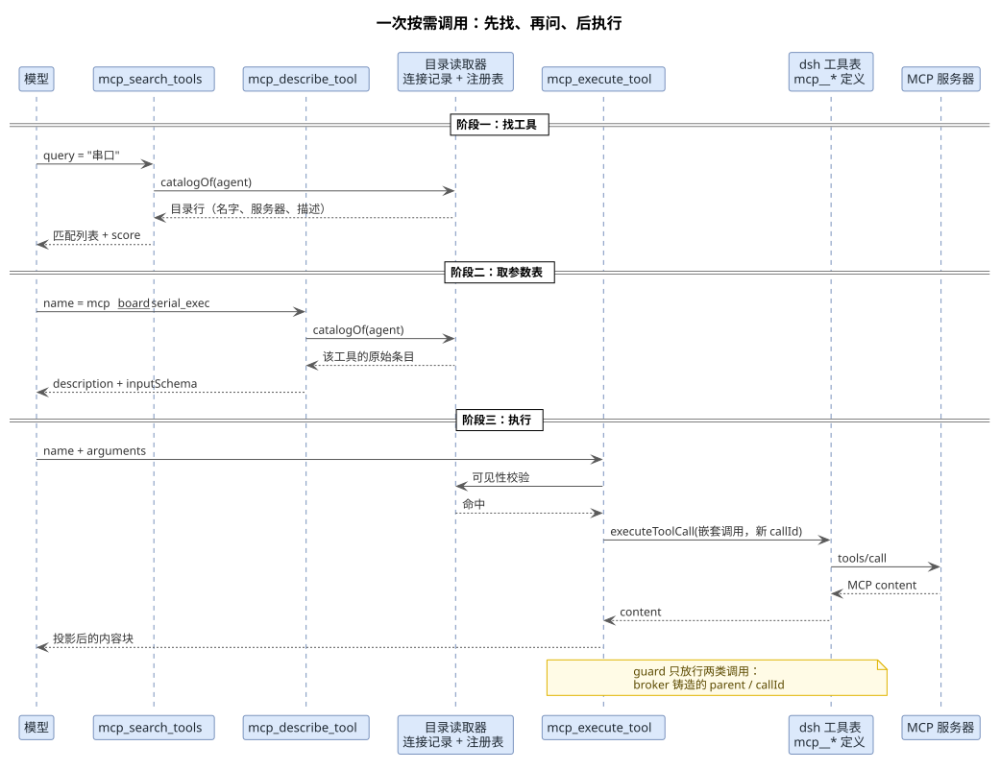

<!-- more -->

本文说明「按需 MCP 工具调用」开关背后的三个工具：`mcp_search_tools`、`mcp_describe_tool`、`mcp_execute_tool`。重点讲清三件事：它们各自凭什么工作、为什么由插件而不是 MCP 服务器注册、开关打开与关闭时模型看到的工具面与执行链路差在哪里。四张原理图分别对应工具归属、一次调用的时序、注册的生命周期与三条隐藏路径。

## 一、 定位与取舍

### 1. 先对齐这些名词

后面会反复出现几个词，它们不在同一个层面，混着读就会晕：

| 名词 | 准确含义 | 在本插件里 |
| --- | --- | --- |
| 注册表 | dsh 的工具总表；`tools.register()` 往里加一条，模型才有机会看到它 | 三个 broker 工具与每条 `mcp__*` 都在这里 |
| `schemas()` 快照 | 注册表按 agent 解析后的可见视图，只有名字、描述与参数，不含执行体 | 会被 `exclude` 掩码过滤、会被桩替换、描述可能被截断 |
| 连接记录 | 插件为每条 MCP 连接维护的状态对象：句柄、连接状态、`tools/list` 原始条目 | 事实源，完整、不截断、不受桩影响 |
| 目录读取器 | broker 中把三段来源合并成一份工具目录的函数 | `createBrokerCatalog()`；搜索与描述都读它 |
| broker | 本插件对这套代理机制的内部叫法，dsh 本身没有这个概念 | 三个工具 + 目录读取器 + guard + 提示词钩子的合称 |
| guard | 插件注册的一道前置检查，返回拒绝理由即中止这次调用 | 拦下绕过 broker 的 `mcp__*` 直调 |
| 影子桩 | 与真实工具同名，但描述只有一行、参数表为空的注册 | 路由无法延迟加载时，用它替换完整定义 |

两个最容易混的地方：

（1）**注册表是给模型的投影，连接记录是插件的事实源。** 同一个工具在注册表里可能是被截断的描述、被掩码挡掉的条目，甚至被换成了空参数的桩；连接记录里始终是服务器 `tools/list` 的原样条目。

（2）**broker 不是 dsh 的模块。** 它只是本插件内部对“三个入口 + 目录读取 + 直调拦截”这一套的简称，代码落在 `src/host/features/mcp/broker/`，插件卸载后什么都不剩。

### 2. 三个工具的身份

它们不是 MCP 工具，也不是 dsh 自带的内置工具，而是本插件通过 `tools.register()` 注册进 dsh 工具表的普通第三方工具。对 dsh 内核与模型来说，它们和 `edit`、`read_file` 这类内置工具平级：同一张注册表、同一套 guard 与权限、同一条调用日志，区别只在注册者与卸载时机。

真实 MCP 工具仍然每条都注册成 `mcp__<服务器>__<工具名>`，`execute` 也没有被替换，只是不再把完整定义送到模型面前。打开开关后，模型侧的常规入口就是这三个工具——直接调用 `mcp__*` 会被 guard 挡下，只有嵌套执行与宿主的 `/mcp call` 例外。



*图 1：三类工具同处一张注册表，差别只在谁注册、谁卸载。*

三者由 [`broker/definitions.ts`](../src/host/features/mcp/broker/definitions.ts#L74-L201) 的 `makeBrokerDefinitions()` 一次性生成，没有 `mcpServerName` / `mcpRawName` 字段——这是与真实 MCP 工具最直接的结构差异，也是 `brokerIdentity()` 无法把它们当成 MCP 工具的原因。

### 3. 它解决的问题

一个 MCP 服务器动辄暴露十几个到几十个工具，每个工具的 `description` 与输入 JSON Schema 都要进模型请求。接上三五个服务器后，光工具定义就可能吃掉数万 token，而任一时刻真正相关的往往只有一两个。

这笔开销的性质是**固定成本**：无论这一轮问的是什么，全部 schema 都得随请求发送。按需代理把它换成**变动成本**：常驻的只有三条固定定义，其余工具的描述与参数表在需要时现取。代价是模型需要额外一到两次往返，且在拿到名字之前无法直接调用。

### 4. 与两侧工具的区别

- **对 MCP 服务器**：三个工具不参与 `initialize` / `tools/list`，服务器不知道它们存在，也不知道此次调用是被人代理转发的。
- **对 dsh**：它们就是普通工具，名字不以 `mcp__` 开头。因此既不会被自己的搜索目录收录（避免递归），也不会被自己安装的 guard 拦下（`isMcpToolName()` 只看前缀）。

## 二、 工具原理

一次完整的按需调用由三段构成：先搜到名字，再问清参数，最后执行。三段共用同一个目录读取器（定义见前面的名词表），但读到的内容层次不同——搜索只要摘要，描述要完整 schema，执行则回到真实定义。



*图 2：`search → describe → execute` 的消息往返；后两步共用目录读取器，执行阶段才进入真实工具。*

### 1. mcp_search_tools

#### 1.1 目录从哪来

搜索结果来自 broker 的目录读取器，而不是注册表的 `schemas()` 快照。两者的差别是“投影”与“事实源”：快照按 agent 裁剪过，描述会被 2000 字上限截断，参数表还可能已经被换成空参数的影子桩；目录读取器则回到连接记录取原样条目。读取顺序分三段，同名条目先到先得：

（1）当前工作区的每个连接：`conn.tools` 全量加入，不做可见性过滤——工作区工具注册在该工作区 agent 自己的表里，只有全局层才有 `exclude` 掩码。

（2）全局连接：只加入 `tools.schemas(agent)` 里可见的 `mcp__*` 名字，`exclude` 掩码与窄视图因此生效。

（3）兜底：注册表里仍未被任何连接覆盖的 `mcp__*` 工具（其他插件注册的，或宿主的原生 MCP 客户端），用定义上的身份字段或公开名切分反推服务器与原始名。

三段合并而非直接查注册表，原因是可见性有两套来源：根注册表按 agent 解析 scope，agent 自己的表才是权威。只信一个，会在“会话中途切换开关”这类时序里得到空目录。

代码见 [`broker/catalog.ts`](../src/host/features/mcp/broker/catalog.ts#L35-L105)。每个目录行只带四个字段：公开名、服务器名、原始工具名、描述。

#### 1.2 为什么是词法检索

工具目录通常只有几十条，规模小到可以每次调用现建索引——重建耗时在微秒级。因此这里选了纯本地词法检索，没有嵌入模型、没有向量库、没有网络请求，也就没有索引失效问题：服务器发出 `notifications/tools/list_changed` 时，下一轮搜索自然读到新目录。

真正的难点是查询词与描述用词不一致：中文提问、英文描述，或 `查日志` 对上 `query logs`。这一层由同义词组解决，不靠语义模型。

#### 1.3 检索算法

排序由四部分加权求和，再乘 100 取整：

（1）**分字段 BM25**：`k1 = 1.2`、`b = 0.75`，字段权重为工具名 3、服务器名 2、描述 1。名字命中比描述命中更重要。

（2）**别名扩展**：查询词按内置的中英同义词组扩张（如 `日志` ↔ `log`、`部署` ↔ `deploy`），扩展词权重 0.5，原始词权重 1。

（3）**模糊兜底**：长度不小于 5 的词做有界编辑距离匹配，长词容错 2、短词容错 1，每个词最多取 5 个候选，权重 0.6。

（4）**精确命中加分**：整串查询出现在工具名或 `服务器__工具` 里加 3 分；查询词与工具名 token 完全相同加 2 分。

实现见 [`broker/search.ts`](../src/host/features/mcp/broker/search.ts#L164-L236) 与 [`broker/aliases.ts`](../src/host/features/mcp/broker/aliases.ts#L15-L54)。

#### 1.4 参数与返回

| 参数 | 说明 |
| --- | --- |
| `query` | 关键词；省略或空串改为浏览目录 |
| `server` | 可选，按服务器名精确过滤（忽略大小写） |
| `limit` | 默认 10，钳制到 1～50 |

返回 `{ query, total, matches }`，`total` 是截断前的命中数；空查询时按 `服务器 + 名称` 字典序返回，`score` 全为 0。每条 hit 的描述截到 300 字符，避免搜索结果本身又撑大上下文。`score` 为整数（内部放大 100 倍），用于让模型判断匹配强度。

### 2. mcp_describe_tool

#### 2.1 读连接记录而非注册表

这是整个设计里最容易出错的一点：当影子桩生效时，注册表里那条 `mcp__*` 定义只有一行描述和空参数表，真实 schema 已经不在注册表里了。因此 `describe` 与 `search` 一样读**连接记录**，`entry.info` 保留着服务器 `tools/list` 的原始条目。

```ts
// src/host/features/mcp/broker/catalog.ts
// 注册表里是桩，记录里是真身：
parameters: convParams(entry.info.inputSchema),
```

同一机制还顺带解决另一处失真：注册时的描述会被 `MAX_DESCRIPTION_LENGTH`（2000 字）截断，而连接记录里是原文。描述被截断的服务器，仍能通过 `describe` 拿到完整说明。

#### 2.2 返回内容

按公开名精确查找，未命中直接报错 `MCP tool "<name>" is not visible in this session`，不做模糊匹配——`describe` 的职责是“确认那一个”，不是“再猜一次”。命中后返回 `{ name, server, tool, description, inputSchema }`。

它与搜索共用同一份目录，因此二者对“有哪些工具、叫什么名字”永远不会给出不同答案。

### 3. mcp_execute_tool

#### 3.1 可见性校验

先按公开名在目录里查一次，查不到就拒绝。这一步不能省：调用名来自模型，不能假定它一定来自上一次 `search` 的结果；一个猜出来的名字若直接打到注册表，就绕过了整套可见性规则。

#### 3.2 为什么重新投回管线

校验通过后，它不自己连 MCP，也不复制一份调用逻辑，而是用一个新 `callId` 把调用重新投回 dsh 工具管线：

```ts
// src/host/features/mcp/broker/definitions.ts
const result = await executeToolCall(tools, {
  callId: nestedCallId,
  rootCallId: exec.rootCallId,
  name,
  arguments: input.arguments ?? {},
  agent: exec.agent,
  parent: exec.token,
  signal: exec.signal,
})
```

`executeToolCall()` 见 [`mcp/execute.ts`](../src/host/features/mcp/mcp/execute.ts#L46-L72)，它同时填了 dsh 0.1 的平铺入参与 0.2 的 `calls` 批量入参，两个版本各读各的字段。最终执行的就是那条 `mcp__*` 定义原本的 `execute`：`callFn` → 连接句柄 `tools/call` → 真实服务器。

这样做的收益是“零重复”：guard、权限、调用日志、图片投影的 `finalizeContent` 全部照常生效，代理没有绕开任何一层，也不需要为代理再写一份超时、重试或错误映射。若改成在 broker 内直接调 `handle.callTool`，这些能力就得实现两遍，且必然逐渐走样。

代价是多一次进程内跳转与一条嵌套调用记录；这在总耗时里可以忽略。

#### 3.3 放行机制

broker 安装的 guard 会拒绝一切直接调用 `mcp__*` 的请求，只对两类放行：

（1）`parent` 在 `approvedParents` 里的调用（dsh 0.1 会把铸造的 token 作为 `parent` 透传）。

（2）`callId` 在 `approvedCallIds` 里的调用（dsh 0.2 的批量入口丢掉 `parent`，但保留 `calls[].id`）。

`mcp_execute_tool` 在嵌套调用前后往这两个集合里增删，`finally` 里清理。`/mcp call` 用 `approveDirectCall(callId)` 走同一套放行，所以命令行入口与模型入口的行为完全一致。两套身份并存不是冗余，而是为了同时兼容两代宿主：只留一套，另一代上代理就调不动自己。

#### 3.4 结果渲染

返回 `{ content }`，由 `renderBrokerExecuteResult()` 投影成 DSH 内容块：空输出补一句 `MCP tool completed with no output.`；裸的 MCP image 块（没有转成 DSH 附件）会被替换成一条诊断文本，避免一张坏图污染会话历史。

并发声明上，`search` 与 `describe` 标为 `isConcurrencySafe: () => true`，`execute` 为 `false`——真实工具可能操作串口、SSH 这类有状态资源。

## 三、 注册原理

### 1. 唯一开关

注册与否只看持久化开关 `onDemandToolInjection`，存放在 `~/.dsh/mcp-manager.json`，默认 `false`。没有任何推导逻辑：不看服务器数量、不看连接状态、不看 agent 类型。



*图 3：关闭时表里只有 `mcp__*`、模型看到全量定义；打开后多出三个入口，并把直调挡在门外。*

两处安装、一处撤销：

（1）插件 `apply` 时开关为真，直接 `broker.install()`。

（2）设置页点开开关，`POST /settings/on-demand` → `setOnDemandToolInjection(true)`。

（3）插件卸载或 dsh 退出，teardown 调 disposer。

持久化为真时插件加载即落在“已注册”态，所以重启 dsh 不会让开关失效。

### 2. install() 做的四件事

`install()` 是这套机制的装配入口，执行完返回一个撤销函数（disposer）。下面按源码顺序摘出四步，省去了收集 disposer 的写法（顺序示意，照 [`broker/runtime.ts`](../src/host/features/mcp/broker/runtime.ts#L237-L250) 的实际写法）：

```ts
// src/host/features/mcp/broker/runtime.ts
runtime.deferDirectTools = true
deps.resyncRegistrations()          // ① 让所有 mcp__* 带上延迟加载标记
for (const definition of makeBrokerDefinitions(...)) tools.register(definition)  // ②
tools.guard(...)                    // ③ 拦住直调
on('system-prompt/assemble', ...)   // ④ 剥离工具清单或打桩
```

顺序不能换：`deferLoading` 是注册签名的一部分，必须先改标志再重建注册，否则重建出来的还是旧形状；三个入口紧随其后注册，guard 与 prompt 钩子最后装上。

`resyncRegistrations()` 分两层：全局注册由 `registry.resyncAll()` 重建，工作区注册由 `scope.rebuildAgentWorkspace()` 逐 agent 重建。之所以必须重建，是因为签名比较的是完整定义（名字、描述、参数、`deferLoading`），改签名等于换一份定义。

三个工具注册在**根注册表**（`platform.tools`）上，因此对所有会话、所有工作区全局可见，不区分 scope。

### 3. 注销与失败回滚

关闭开关时，disposer 先清空两个放行集合，再逆序撤销注册，然后做三件收尾：清掉所有 agent 的影子桩、把 `applyAgentStubMode` 全部置回 `false`、把 `deferDirectTools` 降回 `false` 并再同步一次注册。于是下一轮请求里 `mcp__*` 恢复完整定义，guard 与 prompt 钩子同时消失。

`install()` 内部任何一步抛错，都会把已经完成的注册逆序撤销后重新抛出；`setOnDemandToolInjection` 此时还没写状态文件，所以开关保持原值，不会出现“开关开着但工具只装了一半”的中间态。

### 4. 隐藏直接工具的三种路径

开关只决定“装不装三个工具”，真正让 `mcp__*` 从模型视野里消失的是下面三条路径，按呈现方式与宿主能力依次选择：



*图 4：先看呈现方式，再看宿主版本，最后看路由能力；三条隐藏路径之外，`code` / `both` agent 保留全量。*

| 路径 | 适用 | 做法 | 生效时机 |
| --- | --- | --- | --- |
| 清单过滤 | dsh 0.1.x | `system-prompt/assemble` 拿到 `tools` 数组，过滤掉 `mcp__*` | 当轮 |
| 延迟加载 | dsh 0.2.x，路由声明 `toolUpdate` | 只给注册打 `deferLoading` 标记 | 当轮 |
| 影子桩 | dsh 0.2.x，路由未声明 `toolUpdate` | 同名短桩：描述一行 + 空参数表 | 下一轮 |

判定顺序与图一致：先看组装结果里 `tools:sdk` 段是否非空（`code` / `both` 呈现），再看宿主版本，最后看 `llm.resolveModelInfo()` 返回的 `toolUpdate` 是否为 `in-history` 或 `addition-only`。取不到、抛错、字段缺失一律按“已声明”处理，退回保守形状——模型多看到几条定义只是浪费 token，而错误地延迟加载会让工具在某些路由上直接不可用。

影子桩的定义在 [`broker/shadow.ts`](../src/host/features/mcp/broker/shadow.ts#L54-L61)：保留名字、`execute` 与身份字段，只替换描述与参数表。名字仍然可调，完整 schema 用 `mcp_describe_tool` 现取——这也是 `describe` 必须读连接记录的原因。

三种路径的共同点：**工具始终可执行**，隐藏的是“定义”，不是能力。

### 5. 呈现方式的例外

`code` / `both` 呈现的 agent（组装结果里 `tools:sdk` 段非空）不启用这套代理：不剥离工具清单、不打桩、guard 对其直接放行，只打一条 warn。原因是 broker 的价值建立在“工具被描述”之上，而这类 agent 把工具嵌进生成的代码里用，看不到全量目录反而更糟。

判定发生在每轮 `system-prompt/assemble` 里，且按 agent 记录：同一个会话里切换呈现方式，桩的开关会随之变化（`applyAgentStubMode` 只在状态真的改变时才重建该 agent 的工作区注册，避免每轮抖动）。

## 四、 有与没有的差别

### 1. 模型请求的形状

关闭时，每条 `mcp__*` 带着完整描述与参数表进入请求；工具越多、schema 越大，固定开销越高。

打开后常驻的只有三条固定定义。其余工具的存在感取决于路径：延迟加载下完全不进请求；影子桩下只留名字和一句指针；0.1 的清单过滤下连名字都没有。

### 2. 执行链路

关闭时模型直接调用 `mcp__*`，一跳到达服务器。

打开后至少两跳：先 `search` 找到名字，再 `describe` 取参数表，最后 `execute` 转发。熟悉目录之后可以跳过 `describe` 直接执行，但参数写错只能由服务器报错兜底——broker 不做逐字段校验，`arguments` 原样透传，schema 只用于让模型构造参数。

### 3. 能力边界与代价

- **可见性不变**：目录的全局层仍按 `tools.schemas(agent)` 过滤，`exclude` 掩码与 code agent 的窄视图照旧生效；工作区工具注册在 agent 自己的表里，本来就不受这层掩码。
- **权限不变**：嵌套调用走完整管线，代理不会绕过任何一道守卫。
- **失败模式变化**：名字写错得到 `not visible in this session`，而不是“工具不存在”；参数写错得到服务器原始报错。
- **命令入口不受影响**：`/mcp list`、`/mcp search`、`/mcp call` 始终可用，且与 broker 共用放行机制。
- **多一次决策**：模型要先判断“该搜什么”，再判断“该调哪个”。工具目录混乱或描述质量差时，这一步的收益会明显下降。

### 4. 对照表

| 维度 | 开关关闭 | 开关打开 |
| --- | --- | --- |
| 注册表内容 | 只有 `mcp__*` | `mcp__*` + 三个 broker 工具 |
| 模型可见工具 | 每个 MCP 工具的完整定义 | 三个入口（外加短桩或延迟加载） |
| 直接调用 `mcp__*` | 允许 | 被 guard 拒绝（嵌套执行与 `/mcp call` 除外） |
| 参数表来源 | 请求里自带 | `mcp_describe_tool` 现取 |
| 单次调用往返 | 1 次 | 1～3 次 |
| 上下文固定开销 | 与工具数量成正比 | 三条固定定义 |
| 工具名可猜 | 可从 schema 直接读 | 需先搜到精确名 |
| `code` / `both` agent | 全量 | 仍为全量（例外） |

一句话概括：**开关换掉的是模型的入口，不是工具本身**——MCP 连接、工具注册、执行路径、权限链条都没有变，变的只是“模型先看到什么”。

## 五、 验证方式

### 1. 手工验证

（1）关闭开关，新建会话，确认模型工具列表里没有 `mcp_search_tools`，且 `mcp__*` 可直接调用。

（2）打开开关，新开一轮对话，确认出现三个入口；此时直接调用 `mcp__*` 应被 guard 拒绝。

（3）用 `/mcp list` 与 `/mcp search <关键词>` 对照 broker 目录，确认两者结果一致。

（4）在模型侧走一遍 `search` → `describe` → `execute`，确认参数表与服务器实际 schema 一致。

### 2. 自动化用例

- [`test/broker-search.test.mjs`](../test/broker-search.test.mjs)：检索排序、别名扩展、模糊匹配、`limit` 钳制。
- [`test/shadow-stubs.test.mjs`](../test/shadow-stubs.test.mjs)：影子桩的注册、替换与撤销。
- [`test/mcp-command.test.mjs`](../test/mcp-command.test.mjs)：`/mcp` 命令与 broker 共用放行机制。
- [`test/cases/LV007-MCP影子桩.md`](../test/cases/LV007-MCP影子桩.md)：影子桩的人工复验步骤。

---

*本文档由 markdowncli 技能辅助生成*
